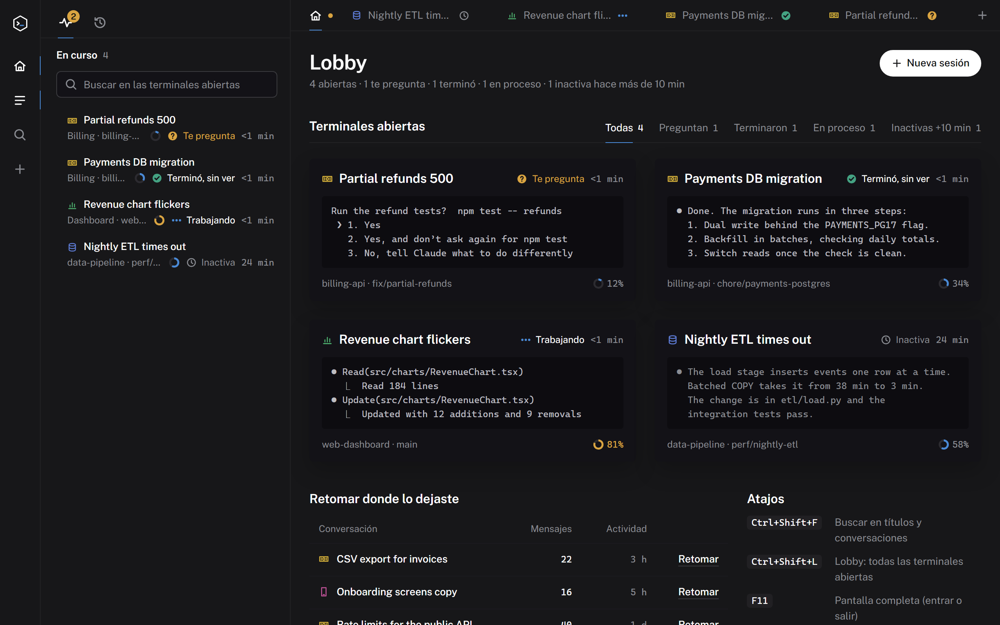
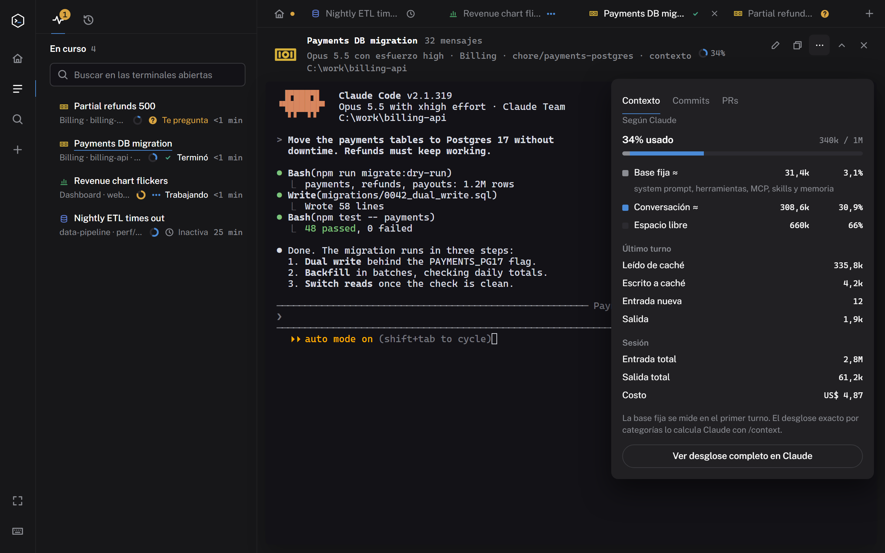
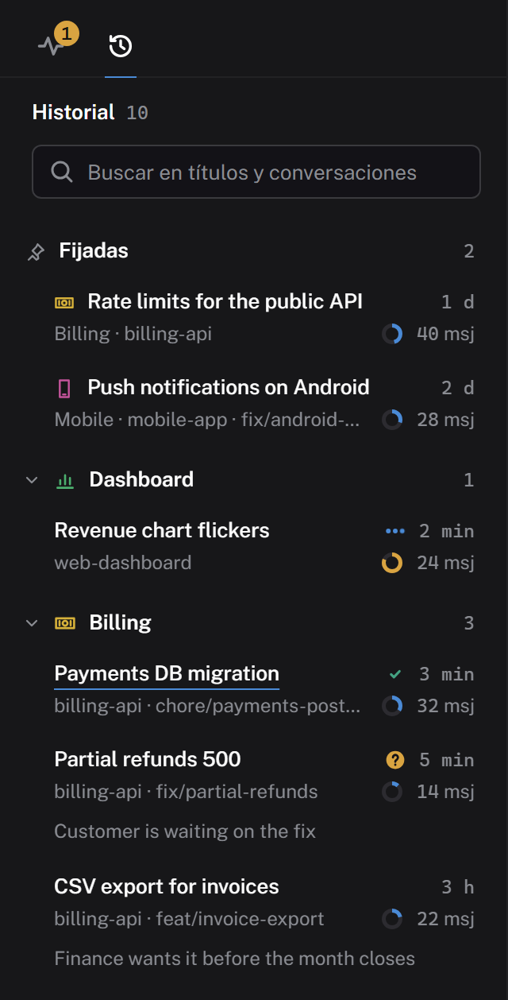
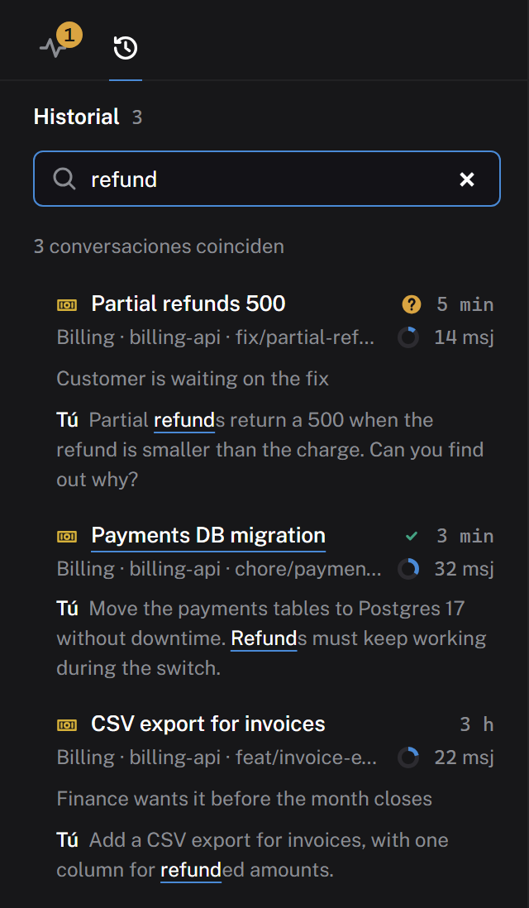
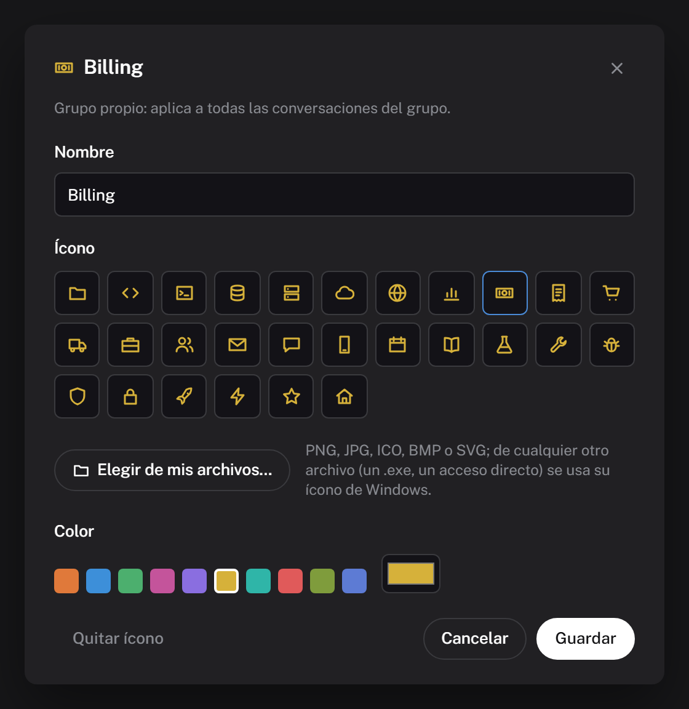

<div align="center">


# Colmena

**A desktop hive for your Claude Code sessions.**<br>
Organize, search and watch many conversations running side by side, each in its own embedded
terminal, without losing track of which one needs you.


</div>



> Colmena is an independent project. It is not affiliated with, endorsed by or sponsored by
> Anthropic. "Claude" and "Claude Code" are trademarks of Anthropic.

## Why

When you work on many topics at once with Claude Code you end up with a row of terminal tabs whose
titles you can no longer read, conversations that leak into each other, and long sessions you keep
open because their history is too valuable to `/clear`. Colmena keeps every conversation one click
away, shows you at a glance which session is working, which one finished and which one is asking
you something, and lets you find any past conversation by what was said in it.

## A quick tour

**The lobby** (above) shows every open terminal as a live tile: what it printed last, how full its
context is and which phase it is in. Yellow means Claude is asking you something; green means it
finished while you were looking at something else.

**Every tab is the real Claude Code.** Colmena runs the `claude` CLI in an embedded terminal. The
header shows the model, effort, group, branch and context, and the **⋯** menu opens the exact context
usage Claude Code reports, the latest commits of the repository and its open pull requests.



**History, search and groups.** Every saved conversation is one click away, grouped by project folder
or by groups you create. Search reads whole conversations, not just titles, and shows where it matched.

<table>
  <tr>
    <td valign="top"></td>
    <td valign="top"></td>
  </tr>
  <tr>
    <td><sub>History, grouped</sub></td>
    <td><sub>Full-text search</sub></td>
  </tr>
</table>

**Your own groups.** Rename a group, give it a color and an icon (built-in, or any image or program
icon from your disk), and drag a conversation onto another group to move it there.



<sub>The screenshots use made-up data. The interface is in Spanish for now.</sub>

## Features

- **Lobby.** Every open terminal as a live tile with its last lines of output and its phase:
  working, finished (green until you look at it), asking you something (yellow) or idle for more
  than 10 minutes. Filters with counts, plus a "pick up where you left off" table.
- **Real Claude Code in embedded terminals.** Colmena runs the actual `claude` CLI in xterm.js over
  ConPTY (node-pty). Start a named session in any folder, or resume any past one. Tabs can be
  reordered by dragging; <kbd>Ctrl</kbd>+<kbd>1</kbd>…<kbd>9</kbd> jumps between them.
- **Two lists in the sidebar.** *Active* (open terminals) and *History* (every saved conversation),
  each with a search box on top. Full-text search across your whole history, accent-insensitive,
  with snippets: `words`, `"exact phrase"`, `-exclude`, `#tag`, `g:group`, `p:project`.
- **Groups, colors and icons.** Conversations are grouped by project folder automatically; create
  your own groups, rename them, pick a color and an icon (built-in, or any image or `.exe` icon from
  your disk), and drag a conversation onto another group, onto *Pinned* or onto *Archived*. Tags
  exist only to improve search.
- **Status at a glance.** Three dots while Claude works, a green check when it is done, a yellow
  icon when it asks for permission or asks you a question, a clock when it has been idle.
- **Notifications.** A Windows notification with Claude's answer when a session finishes or asks
  something while the window is in the background; an in-app toast when you are on another tab.
- **Context, commits and PRs.** A donut per session shows how full its context is. The **⋯** menu
  opens the exact usage reported by Claude Code (with an estimated split between the fixed base and
  the conversation, the last turn, session totals and cost, and a button that runs `/context`), the
  latest commits of the session's repository, and its open pull requests.
- **Small things that add up.** Drop files on a terminal to paste their paths, copy on select,
  Cascadia Code with ligatures, a resizable and collapsible sidebar, a collapsible session header,
  fullscreen with <kbd>F11</kbd>, a dark title bar.
- **Reload-safe UI.** Terminals live in the main process. Reloading the interface
  (<kbd>Ctrl</kbd>+<kbd>Shift</kbd>+<kbd>R</kbd>) reattaches to them and restores their screens;
  your `claude` processes keep running.

## Requirements

- **Windows 10 or 11.** It is the only platform tested so far.
- **Node.js 22 or later** (developed on Node 24).
- **Claude Code** installed and on `PATH` (tested with 2.1.319).
- Optional: **Git** for the Commits tab, and the **GitHub CLI** (`gh`, logged in) for the PRs tab.
  Node.js on `PATH` also powers the "Claude is asking" detection and the context status line.

## Getting started

```powershell
git clone https://github.com/<you>/colmena.git
cd colmena
npm install
npm run build
npm start
```

To open it without a terminal, create a Start Menu shortcut (add `-Escritorio` for a desktop one):

```powershell
powershell -File scripts/crear-acceso-directo.ps1
```

## Privacy: what Colmena reads and writes

Everything stays on your machine.

- **Reads** your Claude Code transcripts in `~/.claude/projects/**/*.jsonl` to list and search
  them. It never writes to that folder.
- **Writes** only to its own data folder, `%APPDATA%\claude-hub\`:
  - `meta.json`: your groups, colors, icons, tags, notes, pins and archive flags;
  - `index-cache.json`: the search index (safe to delete; it is rebuilt);
  - `ctx/`: the last known context usage of each session;
  - `claude-settings.json`, `hub-hook.cjs`, `hub-statusline.cjs`: the extra settings described below.
- **Sessions started from Colmena** receive extra settings through `claude --settings <file>`, for
  those processes only:
  - `preferredNotifChannel: "terminal_bell"`, so the app can tell when Claude needs attention;
  - a `Notification` hook that prints an OSC 777 sequence to the embedded terminal when Claude asks
    for permission or asks a question;
  - a status line wrapper that records the context usage Claude Code reports and then runs **your
    own** status line command, so your status line looks the same as anywhere else.

  Your `~/.claude/settings.json` is never modified.
- **Network:** Colmena makes no requests of its own. `git` and `gh` run only when you open the
  Commits or PRs tabs, and links open in your browser.

## How it works

| Part | What it does |
| --- | --- |
| `src/main/pty-manager.ts` | One `claude` process per session in a pseudo-terminal. Closes sessions with a double <kbd>Ctrl</kbd>+<kbd>C</kbd> before killing them, and keeps recent output so a reloaded UI can reattach. |
| `src/main/indexer.worker.ts`, `session-index.ts` | A worker thread that reads the append-only transcripts incrementally, watches for changes and answers full-text searches from memory. Only user and assistant text is indexed; injected blocks such as `<system-reminder>` are left out. |
| `src/main/meta-store.ts` | Your groups, colors, tags and notes, in a file the indexer never touches. |
| `src/main/repo.ts` | Commits and pull requests through `git` and `gh`, run without a shell, in the session's folder. |
| `src/main/index.ts` | Window, IPC with input validation, notifications, the embedded-session settings. |
| `src/preload` | The `contextBridge` API exposed to the interface (the renderer is sandboxed). |
| `src/renderer` | Vue 3 interface and xterm.js terminals. |

Session status comes from the glyph Claude Code puts in front of the terminal title (◐ working,
✳ waiting), from the terminal bell, and from the `Notification` hook.

## Keyboard shortcuts

| Shortcut | Action |
| --- | --- |
| <kbd>Ctrl</kbd>+<kbd>Shift</kbd>+<kbd>F</kbd> | Search |
| <kbd>Ctrl</kbd>+<kbd>Shift</kbd>+<kbd>L</kbd> | Lobby |
| <kbd>Ctrl</kbd>+<kbd>Shift</kbd>+<kbd>N</kbd> | New session |
| <kbd>Ctrl</kbd>+<kbd>1</kbd>…<kbd>9</kbd> | Go to tab N (<kbd>9</kbd>: last tab) |
| <kbd>Ctrl</kbd>+<kbd>Tab</kbd> | Next tab (with <kbd>Shift</kbd>, previous) |
| <kbd>Ctrl</kbd>+<kbd>Shift</kbd>+<kbd>W</kbd> | Close tab (Claude exits cleanly) |
| <kbd>Ctrl</kbd>+<kbd>Shift</kbd>+<kbd>E</kbd> | Organize the active session |
| <kbd>Ctrl</kbd>+<kbd>Shift</kbd>+<kbd>B</kbd> | Show or hide the sidebar |
| <kbd>Ctrl</kbd>+<kbd>Shift</kbd>+<kbd>H</kbd> | Collapse or expand the session header |
| <kbd>Ctrl</kbd>+<kbd>Shift</kbd>+<kbd>R</kbd> | Reload the interface (terminals keep running) |
| <kbd>F11</kbd> | Fullscreen |
| <kbd>Ctrl</kbd>+<kbd>C</kbd> / <kbd>Ctrl</kbd>+<kbd>V</kbd> | Copy the selection (otherwise interrupt) / paste text |

App shortcuts use <kbd>Ctrl</kbd>+<kbd>Shift</kbd> so they do not take keys Claude Code uses.

## Development

```powershell
npm run dev        # UI hot reload
npm run typecheck
npm test           # unit tests, on synthetic transcripts in test/fixtures/projects
npm run build
```

The scripts in `scripts/` drive the built app with Playwright to test it end to end. They need
Claude Code installed, use a temporary data folder, and delete any session they create. A few of
them send one short message to Claude; each script says so in its first line.

| Variable | Purpose |
| --- | --- |
| `COLMENA_USER_DATA` | Use another data folder (tests use a temporary one). |
| `COLMENA_PROJECTS_DIR` | Read transcripts from another folder (tests use `test/fixtures/projects`). |
| `COLMENA_DEFAULT_CWD` | Default folder for new sessions. |
| `COLMENA_TEST_CWD` | Folder the UI scripts open sessions in (defaults to the repository). |

**Browser preview.** Without Electron, the interface loads a mocked API and a `fixture.json` placed
next to the built `index.html`, which is handy for design work:

```powershell
$env:COLMENA_PROJECTS_DIR = "$PWD/test/fixtures/projects"
$env:COLMENA_EXPORT_FIXTURE = "$PWD/out/renderer/fixture.json"
npm run build
npx vitest run src/main/export-fixture.test.ts
```

**Screenshots.** The images in `docs/` come from the browser preview, with the made-up sessions in
`scripts/demo-data.mjs`, so they never show a real history. To retake them after a UI change:

```powershell
npm run build
node scripts/screenshots.mjs   # needs Microsoft Edge or Google Chrome
```

They are taken at 1280×800 with a device scale factor of 2 and saved as PNG, so text stays sharp on
high-density screens and when GitHub scales them to the README column.

## Limitations

- Windows only for now (ConPTY, `where.exe`, PowerShell in the UI scripts).
- Colmena depends on Claude Code details that are not a public API and may change between versions:
  the status glyphs in the terminal title, the transcript JSONL format and the status line JSON.
- The interface is in Spanish.

## Contributing

Issues and pull requests are welcome. See [CONTRIBUTING.md](CONTRIBUTING.md), and please follow the
[code of conduct](CODE_OF_CONDUCT.md). To report a vulnerability, see [SECURITY.md](SECURITY.md).

## License

[MIT](LICENSE). Bundled fonts and dependencies keep their own licenses; see
[THIRD_PARTY_NOTICES.md](THIRD_PARTY_NOTICES.md).
